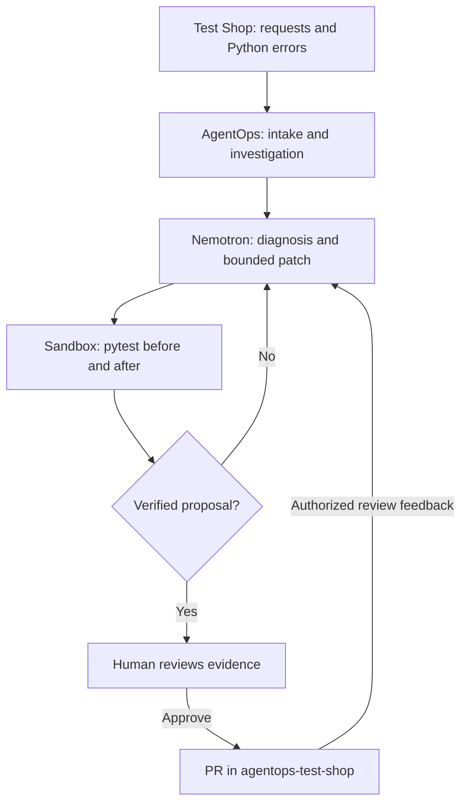

<div align="center">

# 🛒 AgentOps Test Shop
### A Python failure lab for evidence-based AI code repair

**Reproduce an error → Investigate → Repair → Verify → Human approval → Pull request**

[](#-quick-start)
[](#-api-surface)
[](#-test-inventory)
[](https://github.com/yasmeenmh90-beep/NVIDIA-agentops-ai)
[](https://github.com/yasmeenmh90-beep/NVIDIA-agentops-ai)

[Overview](#-overview) · [Run locally](#-quick-start) · [All test runs](#-recorded-agentops-test-runs) · [Regression tests](#-generated-regression-tests) · [Review loop](#-review-feedback-demonstration) · [Judge guide](#-guide-for-judges)

</div>

---

## 💡 Overview

AgentOps Test Shop is the small FastAPI orders service used to demonstrate [AgentOps AI](https://github.com/yasmeenmh90-beep/NVIDIA-agentops-ai), an incident-engineering workspace powered by NVIDIA Nemotron through Nebius Token Factory.

The service provides reproducible failures in pricing, serialization, pagination, and statistics. AgentOps investigates repository evidence, proposes a patch, runs verification, and opens a GitHub PR after a human approves the proposal.

**This repository is the repair target.** The agent orchestration, model inference, dashboard, database, approval controls, and sandbox implementation live in the [main AgentOps AI repository](https://github.com/yasmeenmh90-beep/NVIDIA-agentops-ai).

> **Evidence snapshot — 30 October 2026:** five AgentOps PRs are open and unmerged. The default branch retains the demo defects. Results below are historical values recorded in PR descriptions, not a new CI run or a claim that the current default branch passes every test.

## 🧭 How the repositories connect



The agents operate in the separate AgentOps backend. Test Shop supplies the source code, failure cases, and tests; this repository alone does not call Nemotron.

## 🚀 Quick start

Requires Python 3.11+ and Git.

```bash
git clone https://github.com/yasmeenmh90-beep/agentops-test-shop.git
cd agentops-test-shop
python3 -m venv .venv
source .venv/bin/activate
pip install -r requirements.txt
uvicorn orders.main:app --host 127.0.0.1 --port 8001
```

On Windows, activate with `.venv\Scripts\activate`.

| Local URL | Purpose |
|---|---|
| http://localhost:8001/docs | Interactive Orders API documentation |
| http://localhost:8001/health | Liveness endpoint |
| http://localhost:8000 | Separate AgentOps backend, when running |
| http://localhost:5173 | Separate AgentOps frontend, when running |

Keep Test Shop on port **8001** to avoid conflicting with the AgentOps backend on port **8000**.

Run the tests from the repository root:

```bash
python -m pytest -q
python -m pytest -v --junitxml=test-results.xml
```

Failures are expected on the demo baseline. Each open PR is an independent repair proposal; its results must be interpreted against its own analysed commit.

## 📡 API surface

| Method | Route | Behavior |
|---|---|---|
| GET | `/health` | Returns `{"status":"ok"}` |
| POST | `/orders` | Creates an order and calculates a discounted total |
| GET | `/orders/{order_id}` | Retrieves and serializes an order; 404 if absent |
| GET | `/orders?page=1&size=10` | Returns paginated orders |
| POST | `/admin/reset?seed=25` | Resets the in-memory store with seeded orders |

`orders/stats.py` is present as a module. Historical PR #4 refers to `GET /stats`, but the inspected current `orders/main.py` does **not** expose that route.

The store is seeded with 25 orders at application import. Its records are in memory and are reset on process restart; this is separate from AgentOps' persistent incident database.

### Trigger the recorded baseline failures

```bash
# Pricing: missing discount code leads to a TypeError on the buggy baseline.
curl -X POST http://localhost:8001/orders \
  -H "Content-Type: application/json" \
  -d '{"customer_id":"demo-customer","items":[{"sku":"A","qty":2,"unit_price":50}]}'

# Serialization: stored customer_ref is read as customer_id.
curl http://localhost:8001/orders/1

# Pagination: one-based page indexing and unsafe first-item access.
curl 'http://localhost:8001/orders?page=last&size=10'
```

The service middleware logs unhandled exceptions as structured JSON and returns HTTP 500. Results depend on the checked-out branch.

## 🧪 Recorded AgentOps test runs

**All five PRs record first-attempt verification, zero new failures, and approval by yasmeen.** Unrelated failing tests remain in each run. Counts are independent snapshots and must not be added together as one suite result.

| PR | Incident / repair | Analysed commit | Before: pass / fail | After: pass / fail | Runner |
|---|---|---|---|---|---|
| [#1](https://github.com/yasmeenmh90-beep/agentops-test-shop/pull/1) | Missing discount → `TypeError`; default rate to `0.0` | `125fdee8ca33` | 2 / 4 | 3 / 3 | Subprocess |
| [#2](https://github.com/yasmeenmh90-beep/agentops-test-shop/pull/2) | Customer schema mismatch → `KeyError`; read `customer_ref` | `125fdee8ca33` | 2 / 4 | 3 / 3 | Subprocess |
| [#3](https://github.com/yasmeenmh90-beep/agentops-test-shop/pull/3) | Pagination → `IndexError`; fix indexing and safe first item | `125fdee8ca33` | 2 / 4 | 4 / 2 | Subprocess |
| [#4](https://github.com/yasmeenmh90-beep/agentops-test-shop/pull/4) | Empty orders → `ZeroDivisionError`; return `0.0` | `72205b6190c4` | 3 / 5 | 4 / 4 | Subprocess |
| [#5](https://github.com/yasmeenmh90-beep/agentops-test-shop/pull/5) | Customer schema repair with two added regression tests | `116002e7e8d4` | 2 / 6 | 5 / 3 | Docker |

### What each repair demonstrates

<details>
<summary><b>PR #1 — Missing or unknown discount code</b></summary>

`discount_rate()` returned `None` for absent codes. `order_total()` then tried to calculate `1 - None`.

The patch uses `DISCOUNT_CODES.get(code, 0.0)`. The recorded fixed test is `test_create_order_without_discount`; pagination and serialization failures remain.

</details>

<details>
<summary><b>PR #2 — Stored schema versus public API</b></summary>

The store saves the customer reference under `customer_ref`, while the serializer read `customer_id`.

The patch reads the current storage key and preserves the public response field `customer_id`. The recorded fixed test is `test_get_order_returns_customer_id`.

</details>

<details>
<summary><b>PR #3 — Pagination indexing and bounds</b></summary>

The baseline calculates `start = page * size` despite one-based page numbering, then indexes the source list without a bounds guard.

The patch uses `(page - 1) * size`, clamps the requested page, and reads the first ID from the resulting chunk when available. It fixes `test_first_page_starts_at_first_order` and `test_last_page`. The approval note explicitly calls out page clamping as a behavior choice to review.

</details>

<details>
<summary><b>PR #4 — Empty-list statistics and reviewer revision</b></summary>

`average_order_value()` divides by the number of orders without checking for an empty list.

The patch returns `0.0` for an empty list and adds two test functions. The empty-list regression test is recorded as failing before the repair and passing afterward. A later reviewer request removes an unused test import; AgentOps posts a re-verification result and a revision commit.

</details>

<details>
<summary><b>PR #5 — Docker verification and two regression tests</b></summary>

The serializer repair is paired with tests for both a record created through the store and a directly constructed dictionary.

Both new regression tests are recorded as failing before the patch and passing afterward. The PR reports Docker execution, three fixed tests, and zero new failures. Three unrelated failures remain. The approval note identifies the run as a fix from a Sentry alert; the PR does not include the original Sentry delivery logs.

</details>

## 📋 Test inventory

### Existing tests on the inspected default branch

All six are in [tests/test_orders.py](tests/test_orders.py).

| Test | Expected behavior |
|---|---|
| `test_health` | Health endpoint returns the expected JSON |
| `test_create_order_with_discount` | Two items at 50 with WELCOME10 total 90 |
| `test_create_order_without_discount` | Missing discount leaves the total at 100 |
| `test_get_order_returns_customer_id` | Serialized order returns the owning customer ID |
| `test_first_page_starts_at_first_order` | Page 1 contains IDs 1–10 |
| `test_last_page` | Last page contains IDs 21–25 and reports 3 pages |

### 🧬 Generated regression tests

These files exist on the respective PR branches, not on `main` while the PRs remain unmerged.

| PR | File / test function | Evidence |
|---|---|---|
| #4 | `tests/test_regression_zero_division.py::test_average_order_value_empty_list` | Recorded fail before / pass after |
| #4 | `tests/test_regression_zero_division.py::test_average_order_value_with_orders` | Non-empty average remains correct; not listed as a newly failing-before regression |
| #5 | `tests/test_regression_customer_id_keyerror.py::test_serialize_order_reads_customer_ref` | Recorded fail before / pass after using a stored record |
| #5 | `tests/test_regression_customer_id_keyerror.py::test_serialize_order_direct_dict` | Recorded fail before / pass after using a direct dictionary |

PRs #1–#3 document repairs verified against existing tests. Their descriptions do not show newly added regression tests.

### Check a PR locally

Use a separate clone or ensure your working tree is clean before switching:

```bash
# Example: inspect and test the Docker-recorded repair from PR #5.
git fetch origin pull/5/head:review-pr-5
git switch review-pr-5
python -m pytest -v

# Run only the added regression tests.
python -m pytest -v tests/test_regression_customer_id_keyerror.py

# Return to the default branch.
git switch main
```

This command runs pytest locally; it does not reproduce the original Docker environment. A repaired PR may still have unrelated failures.

## 🔁 Review feedback demonstration

[PR #4 discussion](https://github.com/yasmeenmh90-beep/agentops-test-shop/pull/4#issuecomment-6444728140) records this request:

```text
/agentops remove the unused pytest import from the regression test
```

AgentOps subsequently:

1. Removed the unused import.
2. Reported that the empty-list regression still failed on the original code and passed on the repaired code.
3. Reported zero new failures.
4. Pushed [revision commit f8f24da](https://github.com/yasmeenmh90-beep/agentops-test-shop/commit/f8f24da1eb51d698b68e535bf1cb413b69b1b4f4).

This demonstrates a recorded review-to-revision loop. The open PR does not demonstrate a completed merge/resolution event.

## 🔌 Connect this target to AgentOps AI

Start the [AgentOps application](https://github.com/yasmeenmh90-beep/NVIDIA-agentops-ai#readme), then register this repository through its Repositories page:

| Setting | Value |
|---|---|
| Project name | `test-shop` |
| Repository URL | `https://github.com/yasmeenmh90-beep/agentops-test-shop.git` |
| Default branch | `main` |
| Test command | `python -m pytest -q` |

Wait for repository setup to become ready. Submit the traceback through **Send a test error** or the documented AgentOps ingestion API. Configure model and GitHub credentials in the **AgentOps backend**, not in this target service.

The built-in `AGENTOPS_INGEST_URL` shipper sends a payload containing `source` and `lines`, without an API-key header or project field. For the current authenticated, project-scoped AgentOps API, use the documented intake/client or an adapter that supplies those fields; setting this URL alone is not sufficient for direct integration.

## 🗂️ Repository layout

```text
agentops-test-shop/
├── orders/
│   ├── main.py           Orders API and exception middleware
│   ├── logging_setup.py  Structured errors and optional HTTP shipper
│   ├── pricing.py        Discount and total calculations
│   ├── serializers.py    Stored record → response mapping
│   ├── pagination.py     Page selection and response metadata
│   ├── stats.py          Average-order-value calculation
│   ├── shipping.py       Shipping-rate helper
│   └── store.py          In-memory records and seed/reset logic
├── tests/
│   ├── conftest.py
│   └── test_orders.py    Six default-branch API tests
├── pytest.ini
├── requirements.txt
└── README.md
```

## 🏁 Guide for judges

- Start with **PR #5** for the patch, two regression tests, recorded Docker verification, and human approval.
- Open **PR #4** for the root-cause explanation, generated tests, review discussion, and revision commit.
- Inspect **PRs #1–#3** for the earlier pricing, serialization, and pagination demonstrations.
- Compare before/after counts within a single PR. Existing unrelated failures are explicitly reported.
- Use the [main AgentOps AI repository](https://github.com/yasmeenmh90-beep/NVIDIA-agentops-ai) for architecture, model usage, application setup, backend tests, and the project license.

The test-shop results are separate from the main AgentOps backend test suite. Public PRs expose code changes and discussion; their recorded sandbox results have not been independently rerun as part of this README update.

---

<div align="center">

**Small failures. Inspectable repairs. Human-controlled delivery.**

A demonstration target for **AgentOps AI** · Nebius × NVIDIA Global AI Hackathon

</div>
